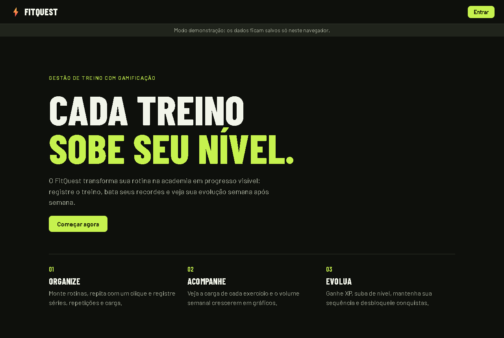
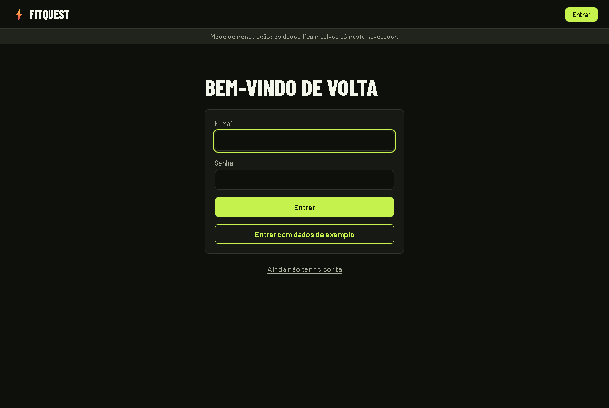
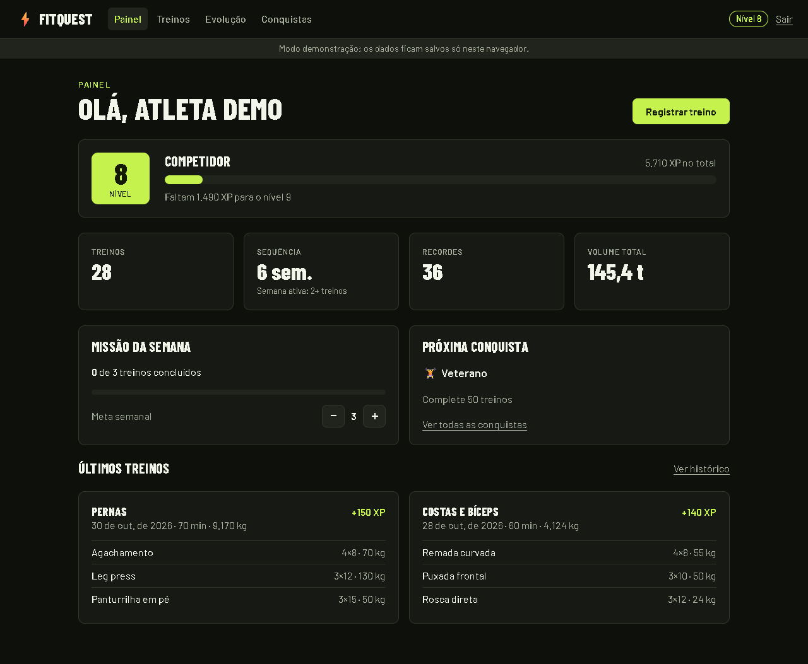
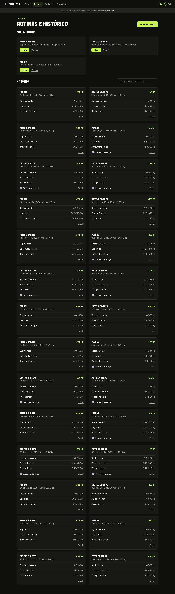
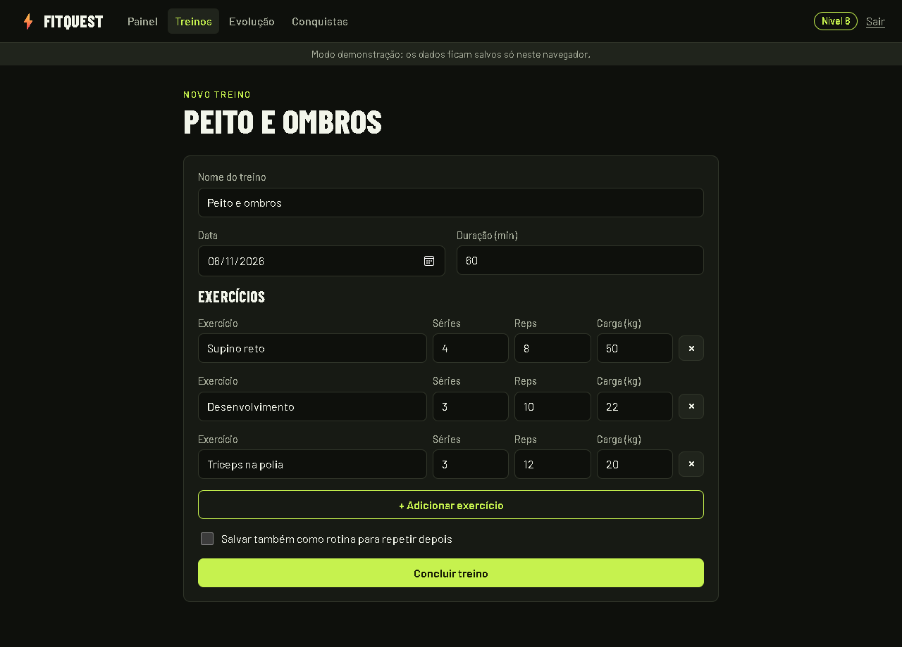
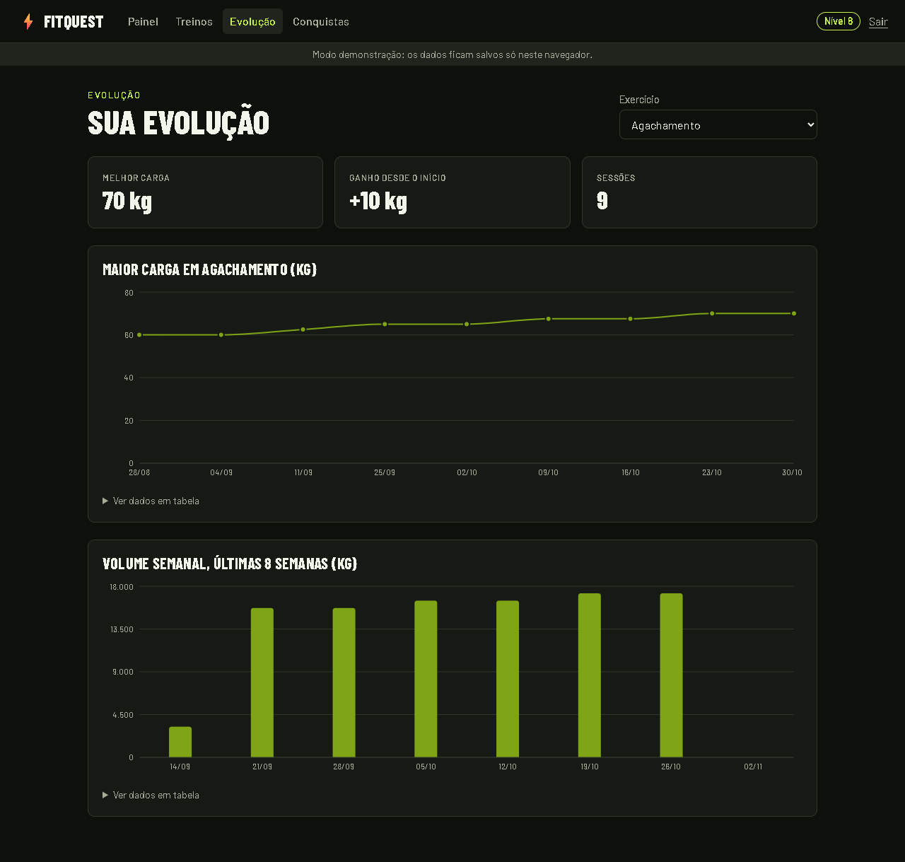
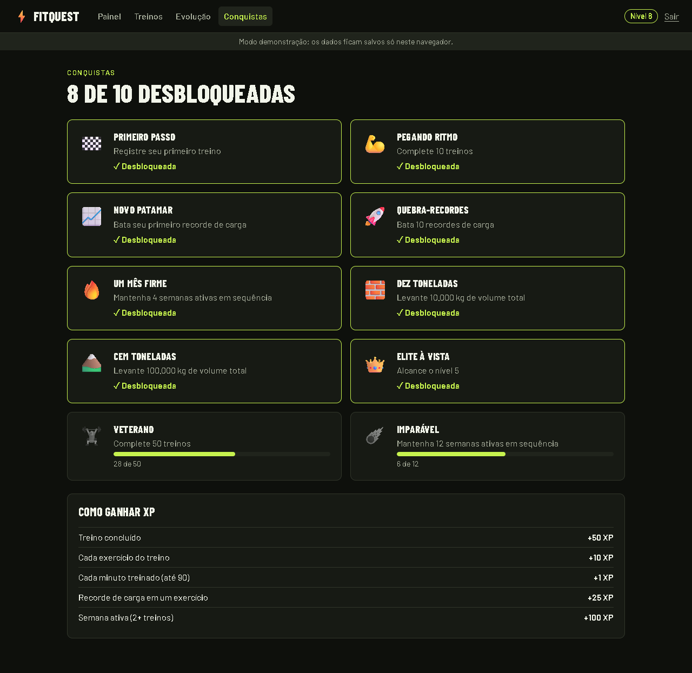

# FitQuest

Aplicação web de gestão de treinos, acompanhamento da evolução e gamificação. O usuário registra treinos, monta rotinas, vê gráficos de carga e volume, ganha XP, sobe de nível e desbloqueia conquistas.

Trabalho final da disciplina **Front-end Frameworks** (Ciência da Computação), feito com **React.js e TypeScript**.

**Deploy:** _(preencher, se houver)_

## Integrantes e componentes

Cada integrante é responsável por criar e explicar 2 componentes e 2 hooks.

| Integrante | Componentes | Hooks | O que fazem |
|---|---|---|---|
| Thiago Victor | [`Navbar`](src/components/Navbar.tsx), [`ProtectedRoute`](src/components/ProtectedRoute.tsx) | `useNavigate`, `useLocation` | Navegação principal e bloqueio das rotas internas |
| Eduardo Martins | [`WorkoutForm`](src/components/WorkoutForm.tsx), [`ExerciseRow`](src/components/ExerciseRow.tsx) | `useEffect`, `useRef` | Formulário de treino e linha de cada exercício |
| Esdras Elohim | [`WorkoutCard`](src/components/WorkoutCard.tsx), [`RoutineCard`](src/components/RoutineCard.tsx) | `useContext`, `useTraining` | Exibição de treinos e de rotinas |
| Ruan Bandeira | [`ProgressChart`](src/components/ProgressChart.tsx), [`StatCard`](src/components/StatCard.tsx) | `useState`, `useMemo` | Gráficos de evolução e cartões de estatística |
| Sara | [`XPBar`](src/components/XPBar.tsx), [`AchievementBadge`](src/components/AchievementBadge.tsx) | `useGamification`, `useLocalStorage` | Barra de nível e cartão de conquista |

### Onde mostrar cada hook na apresentação

| Integrante | Hook | Arquivo para mostrar | Ligação com os componentes |
|---|---|---|---|
| Thiago Victor | `useNavigate` | [`Navbar.tsx`](src/components/Navbar.tsx) | Volta para a página inicial depois de sair da conta |
| Thiago Victor | `useLocation` | [`ProtectedRoute.tsx`](src/components/ProtectedRoute.tsx) | Guarda a página pedida para voltar a ela depois do login |
| Eduardo Martins | `useEffect` | [`ExerciseRow.tsx`](src/components/ExerciseRow.tsx) e [`TrainingContext.tsx`](src/contexts/TrainingContext.tsx) | Dá foco à linha nova e assina os treinos do Firestore em tempo real |
| Eduardo Martins | `useRef` | [`ExerciseRow.tsx`](src/components/ExerciseRow.tsx) | Guarda a referência do campo que recebe o foco |
| Esdras Elohim | `useContext` | [`useTraining.ts`](src/hooks/useTraining.ts) | Lê os treinos e rotinas do contexto sem passar props |
| Esdras Elohim | `useTraining` | [`WorkoutsPage.tsx`](src/pages/WorkoutsPage.tsx) | Fornece os treinos e rotinas exibidos nos cartões e as funções de excluir |
| Ruan Bandeira | `useState` | [`ProgressPage.tsx`](src/pages/ProgressPage.tsx) | Guarda o exercício escolhido para o gráfico |
| Ruan Bandeira | `useMemo` | [`ProgressPage.tsx`](src/pages/ProgressPage.tsx) | Só recalcula os dados do gráfico quando os treinos ou o exercício mudam |
| Sara | `useGamification` | [`useGamification.ts`](src/hooks/useGamification.ts), [`DashboardPage.tsx`](src/pages/DashboardPage.tsx) e [`AchievementsPage.tsx`](src/pages/AchievementsPage.tsx) | Calcula o XP e o nível mostrados na `XPBar`, no Painel, e as conquistas mostradas nos cartões, na página de Conquistas |
| Sara | `useLocalStorage` | [`useLocalStorage.ts`](src/hooks/useLocalStorage.ts) e [`DashboardPage.tsx`](src/pages/DashboardPage.tsx) | Guarda a meta semanal do painel no navegador |

## Requisitos do trabalho

| Requisito | Como foi atendido |
|---|---|
| Mínimo de 8 componentes funcionais | 10 componentes em `src/components`, além das páginas |
| Mínimo de 5 páginas | Início, Login, Painel, Treinos, Novo treino, Evolução e Conquistas, além da página 404 |
| Mínimo de 4 hooks diferentes | Ver a tabela abaixo |
| TypeScript | Todo o código em `.ts` e `.tsx` |
| Backend ou API (opcional) | Firebase Authentication e Cloud Firestore |

### Hooks utilizados

| Hook | Onde | Para quê |
|---|---|---|
| `useState` | Formulários e páginas | Guardar valores dos campos e estados da interface |
| `useEffect` | `AuthContext`, `TrainingContext`, `LoginPage`, `ExerciseRow` | Assinar dados do Firebase e controlar o foco |
| `useContext` | `useAuth`, `useTraining` | Ler usuário e treinos sem passar props por toda a árvore |
| `useRef` | `LoginPage`, `ExerciseRow` | Levar o cursor ao campo certo |
| `useMemo` | `useGamification`, `ProgressPage` | Evitar recalcular XP e gráficos sem necessidade |
| `useCallback` | `TrainingContext`, `useLocalStorage` | Manter funções estáveis entre renderizações |
| `useAuth` (custom) | [`src/hooks/useAuth.ts`](src/hooks/useAuth.ts) | Acessar o usuário logado |
| `useTraining` (custom) | [`src/hooks/useTraining.ts`](src/hooks/useTraining.ts) | Acessar e alterar treinos e rotinas |
| `useGamification` (custom) | [`src/hooks/useGamification.ts`](src/hooks/useGamification.ts) | Calcular XP, nível, sequência e conquistas |
| `useLocalStorage` (custom) | [`src/hooks/useLocalStorage.ts`](src/hooks/useLocalStorage.ts) | Guardar a meta semanal no navegador |
| `useNavigate` (React Router) | `Navbar`, `DashboardPage`, `NewWorkoutPage` | Mudar de página pelo código |
| `useLocation` (React Router) | `ProtectedRoute`, `LoginPage`, `DashboardPage` | Ler a página atual e dados enviados entre páginas |
| `useSearchParams` (React Router) | `NewWorkoutPage` | Ler a rotina escolhida na URL |

## Como rodar

É necessário ter o [Node.js](https://nodejs.org/) instalado. Na pasta do projeto, execute:

```bash
npm install
npm run dev
```

Depois, abra o endereço que aparecer no terminal, normalmente `http://localhost:5173`.

Sem configurar o Firebase, o app abre em **modo demonstração**: os dados ficam só no navegador e a senha não é verificada. Na tela de login, **Entrar com dados de exemplo** carrega um histórico de 10 semanas.

## Como configurar o Firebase

1. Crie um projeto no [console do Firebase](https://console.firebase.google.com/).
2. Em **Authentication > Sign-in method**, ative **E-mail/senha**.
3. Em **Firestore Database**, crie o banco de dados.
4. Na aba **Regras** do Firestore, cole o conteúdo de [`firestore.rules`](firestore.rules) e publique.
5. Em **Configurações do projeto > Seus apps**, registre um app Web e copie os valores de configuração.
6. Copie `.env.example` para `.env.local`, preencha os valores e reinicie o `npm run dev`.

O aviso de modo demonstração desaparece quando a configuração é carregada. O arquivo `.env.local` não vai para o GitHub. No deploy, cadastre as mesmas variáveis no serviço de hospedagem e adicione o domínio em **Authentication > Settings > Authorized domains**.

## Gamificação

Todo o progresso é calculado a partir da lista de treinos em [`src/lib/gamification.ts`](src/lib/gamification.ts). Por isso, excluir um treino atualiza XP, nível e conquistas automaticamente.

| Ação | XP |
|---|---|
| Treino concluído | +50 |
| Cada exercício do treino | +10 |
| Cada minuto treinado, até 90 | +1 |
| Recorde de carga em um exercício | +25 |
| Semana ativa (2 ou mais treinos) | +100 |

O XP acumulado para alcançar cada nível é `100 × nível × (nível − 1)`: 200 XP para o nível 2, 600 para o 3, 1.200 para o 4, e assim por diante.

## Telas

As telas abaixo foram capturadas no modo demonstração, com os dados de exemplo.

### Início


### Login


### Painel


### Treinos


### Novo treino


### Evolução


### Conquistas


## Estrutura

```text
src/
├── components/   10 componentes do grupo
├── contexts/     Estado global de autenticação e treinos
├── hooks/        Hooks personalizados
├── lib/          Regras de gamificação e funções de data
├── pages/        Páginas da aplicação
└── services/     Firebase e modo demonstração, com o mesmo contrato
```

## Tecnologias

React, TypeScript, Vite, React Router, Firebase e Recharts.
